# Mitzi

An open-source, Claude-style AI workspace that runs on **any model available through [OpenRouter](https://openrouter.ai)**, or directly on **OpenAI, Anthropic, Google Gemini, xAI, Groq, Mistral, DeepSeek, Together, Ollama, LM Studio** or any OpenAI-compatible API with your own keys. It runs locally in your browser and offers chats, projects, artifacts, documents, custom bots, long-term memory, scheduled tasks, image/video/audio generation, voice conversations, and context management. When a project points at a folder, Mitzi also works as a coding agent that edits files and runs commands there. A terminal version is included.

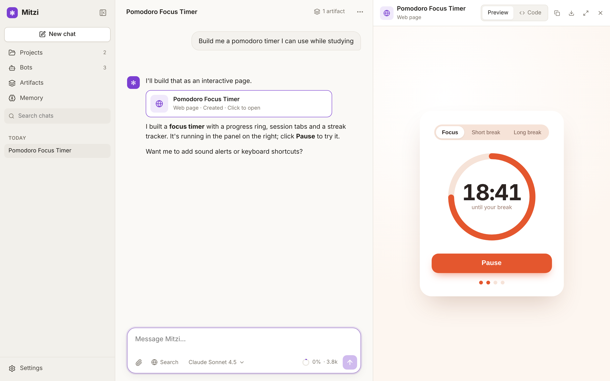

## Features

**Chats**
- Responses stream in with Markdown, tables and syntax-highlighted code.
- Attach text files or images. You can paste or drag and drop them into the message box.
- Edit any earlier message, regenerate the last answer, stop a response mid-stream, and copy replies.
- Switch models per chat. The model picker is searchable and shows each model's price, context size, and vision and tool support.
- One-click web search uses OpenRouter's `:online` option.
- Chats get titles automatically. You can pin, rename, search, and move chats between projects.
- **Branch** a chat from any answer: the new chat has the conversation up to that point (and copies of its artifacts), and the original stays as it was.
- **Read aloud** any answer, with your browser's voices or a natural voice from OpenAI or ElevenLabs.
- **Rate answers** with 👍 / 👎 and an optional comment. The bot distills each rating into a lesson ("Keep explanations short and lead with an example"), keeps it in mind in later chats and saves it to its memory bank. Lessons are listed, and can be removed, in the bot's settings.

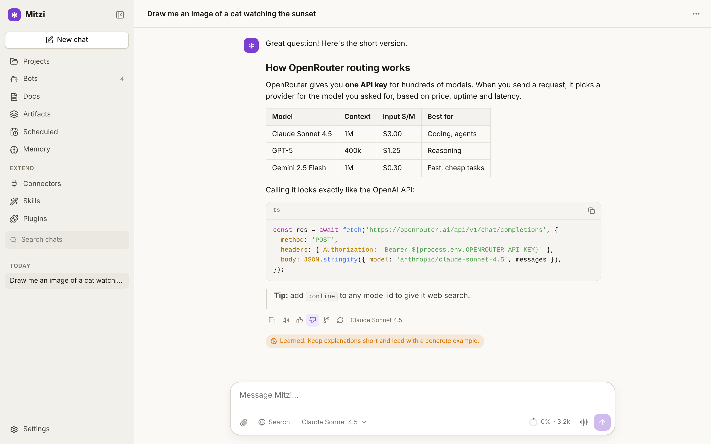

**Providers.** Add as many providers as you like in Settings → Providers. Each provider's models appear in the model picker, grouped by provider, with ids like `openai:gpt-5`, `anthropic:claude-sonnet-4-5` or `google:gemini-2.5-pro`; OpenRouter ids stay as they are (`anthropic/claude-sonnet-4.5`). Anthropic is called through its native Messages API (with prompt caching); the others through their OpenAI-compatible APIs. Keys can also come from environment variables (`OPENAI_API_KEY`, `ANTHROPIC_API_KEY`, `GEMINI_API_KEY`, `XAI_API_KEY`, …).

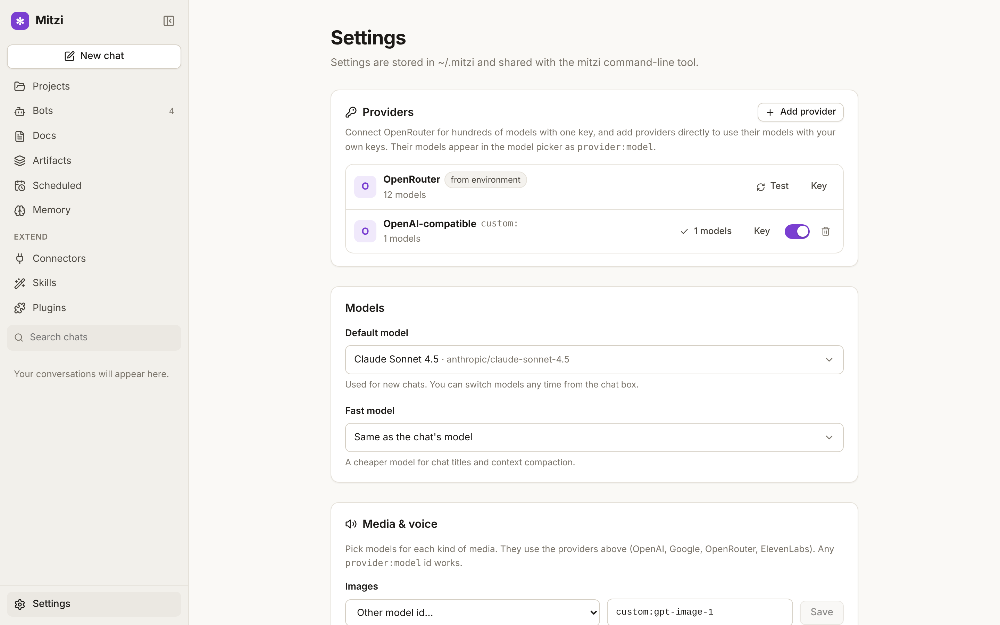

**Live conversation.** Press the waveform button in the message box to talk hands-free: Mitzi listens, answers out loud, and listens again. You can interrupt it mid-answer. It uses the browser's speech recognition, or a transcription model (e.g. Whisper) in browsers without one.

**Media generation.** Bots can create images (OpenAI GPT Image, Google Imagen and Gemini "Nano Banana", or image models on OpenRouter), short videos (OpenAI Sora, Google Veo), speech, sound effects and music (ElevenLabs). In Settings → Media & voice, each kind has the same searchable model picker as chat models, filled from your providers' own model lists. Results play inline in the chat and are saved as artifacts.

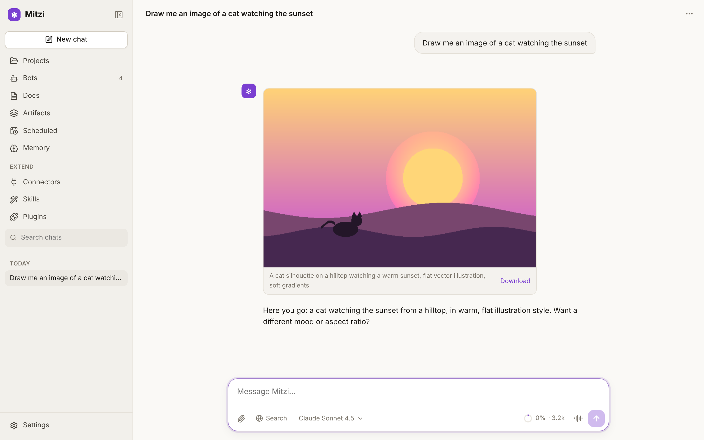


**Scheduled tasks.** Prompts that run on their own: once, every N minutes, daily, weekly or on a cron schedule. Each run is answered by the bot you choose (optionally in a project) and saved as a chat, either a new one per run or one continuing chat. The sidebar shows a badge when new results arrive. Tasks run while Mitzi is open; missed runs catch up when it starts. Tools that normally ask for permission are skipped in unattended runs unless you allow them for that task.

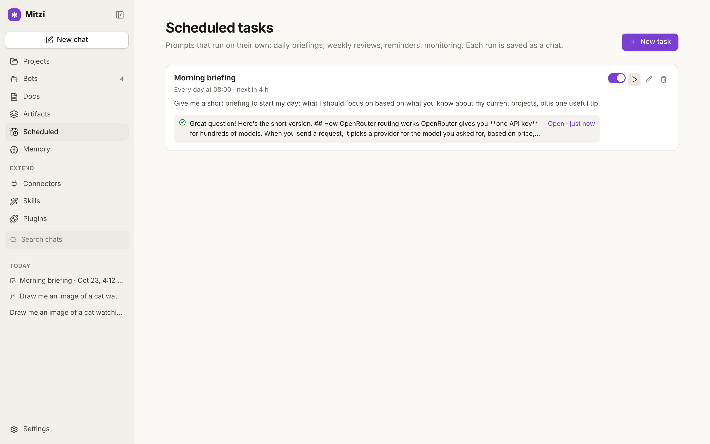

**Artifacts.** Substantial output opens in a side panel instead of cluttering the chat:
- Types: documents, presentations, web pages, React components, code files, SVG graphics, Mermaid diagrams, and generated images, video and audio.
- Web pages, components, SVG and diagrams render live in a sandboxed frame; presentations show as slides with a full-screen presenter mode.
- The model edits artifacts in place with small targeted updates instead of rewriting them each time.
- All artifacts are collected in a gallery. Start a new document, presentation, web page, component, script or diagram there from a short brief, and the bot makes the first version.

**Workspace.** Open any artifact to work on it in the style of Gemini Canvas or Claude's docs: the artifact on the left, its chat on the right.
- Edit it yourself (a Read/Write view for documents and slides, Preview/Code for web pages and components), or ask the bot for changes.
- Select any passage to comment on it or ask about it. "Address all" has the bot work through your comments: it makes the changes, replies and resolves each thread.
- Every change, yours or the bot's, is a version you can view and restore.

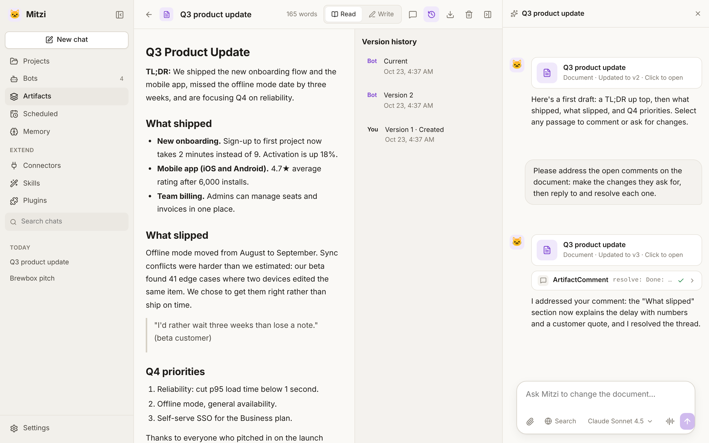

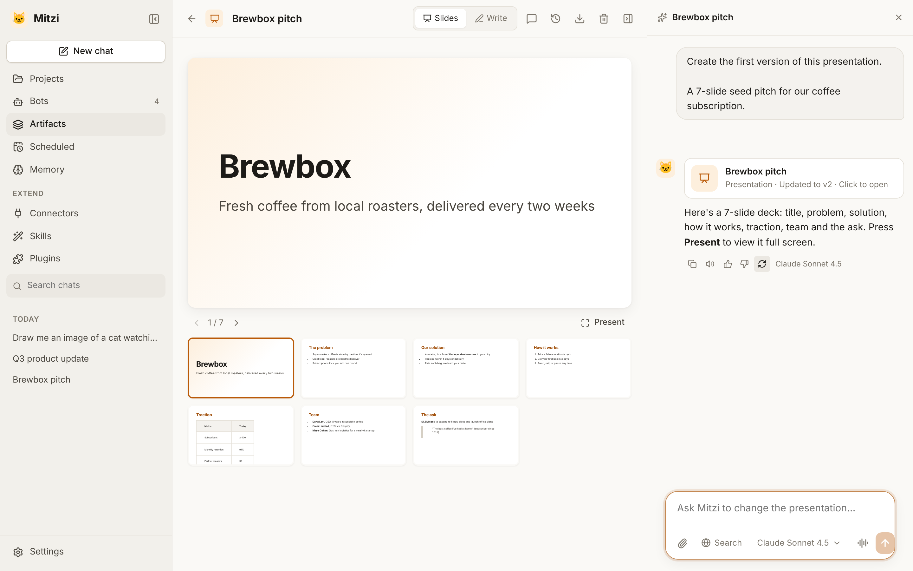

**Projects** group chats around shared context:
- *Instructions* are added to every chat in the project.
- *Knowledge files* are reference documents included in every chat's context.
- A *coding workspace* links a local folder. Chats in the project then get Read, Write, Edit, Bash, Glob, Grep and the other coding tools, with a permission prompt (showing a diff) before anything changes.
- **Pick where to work from the message box:** the project button next to the model picker sets a new chat's project, or moves an existing chat. From the same menu:
  - **Open a folder…** browses the folders on your computer and starts working there (Mitzi makes a project for the folder, or reuses the one it has).
  - **Connect a repository…** clones a GitHub, GitLab or any git repository (`owner/repo`, an https or SSH URL, a branch, and an access token for private ones) and opens it as a project. The project page shows its branch, local changes and commits to push or pull, with a **Pull latest** button. Tokens are stored only on your computer and never written into the repository's config.

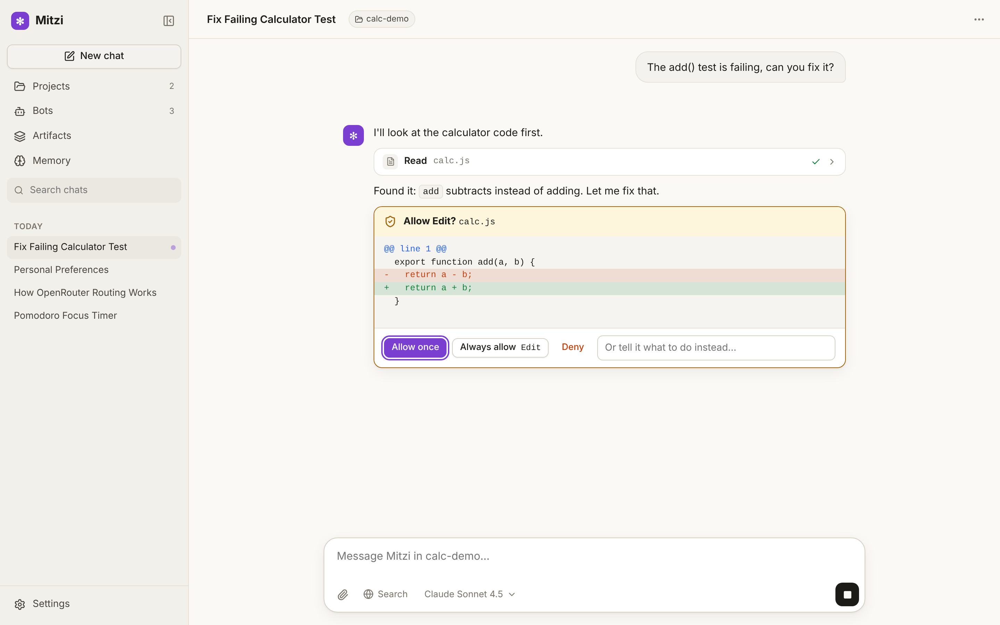

**Bots** are reusable assistants with their own icon, instructions, model, temperature, capabilities and conversation starters. Once a bot knows you, the starters on the new-chat screen are written from its memories and your recent conversations ("Make a study plan for my biology exam on Nov 12"), and refresh as you keep talking. **Mitzi** 🐱, the default bot, is always there and handles every chat that doesn't pick another bot. You can customize it but not delete it. Three example bots are included.

**Memory banks.** Every bot has its own long-term memory, modeled on [Hindsight](https://github.com/vectorize-io/hindsight)'s retain → recall → reflect design:
- **Retain:** after each exchange, the bot extracts durable *facts* (about you and your world) and *experiences* (what it did for you). It then consolidates them into *beliefs* (observations) that cite their supporting facts and grow more confident as evidence accumulates. Contradicting facts revise beliefs rather than piling up.
- **Recall:** before every message, relevant memories are retrieved by several strategies at once: keyword (BM25), an entity graph, time expressions ("last week", "in March") and, optionally, semantic embeddings. Reciprocal rank fusion merges the results within a token budget. Each answer shows which memories it used.
- **Reflect:** ask a bank a broad question and it reasons over everything it remembers.
- **Per-bank settings:** each bank has a *mission* (what to focus on) and a *disposition* (skepticism, literalism and empathy, 1–5) that shapes how memories are formed and interpreted.
- **Memory page:** browse, search, edit, forget or teach each bank, test recall, or ask it to reflect. The model can also save, search and forget memories itself.
- **Import from other AIs:** like Gemini's memory import. Mitzi gives you a prompt to run in ChatGPT, Claude or Gemini; paste the answer back and Mitzi splits it into separate memories for you to review, edit and save to any bot. You can also import your **chat history** from a ChatGPT or Claude data export (the .zip, unpacked in your browser): conversations appear in your chat list and can be continued, and Mitzi can learn about you from the most recent ones in the background.
- **Hindsight server (optional):** you can point Mitzi at a real Hindsight server instead of the built-in engine (Settings → Memory).

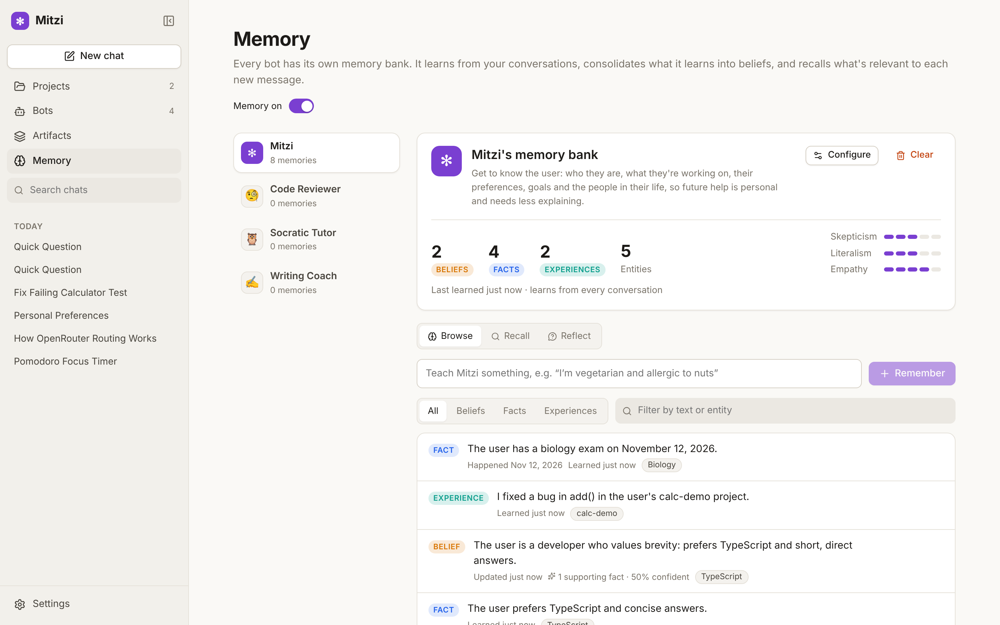

**Connectors (MCP).** Give any bot tools from your apps through the [Model Context Protocol](https://modelcontextprotocol.io):
- **Directory:** one-click connectors for Notion, Linear, Atlassian, Sentry, Vercel, Supabase, Stripe, GitHub, Hugging Face, Context7 and DeepWiki, plus local ones (Filesystem, Browser/Playwright, Brave Search, Git, Fetch, Sequential Thinking).
- **Custom servers:** add any MCP server over stdio (a local command), Streamable HTTP, or the older SSE transport.
- **Sign-in:** remote servers that use OAuth sign in through the browser, following the MCP authorization spec (discovery, dynamic client registration, PKCE, token refresh).
- **Permissions:** per connector, choose *ask every time*, *allow read-only tools*, or *always allow*, and turn individual tools on or off.

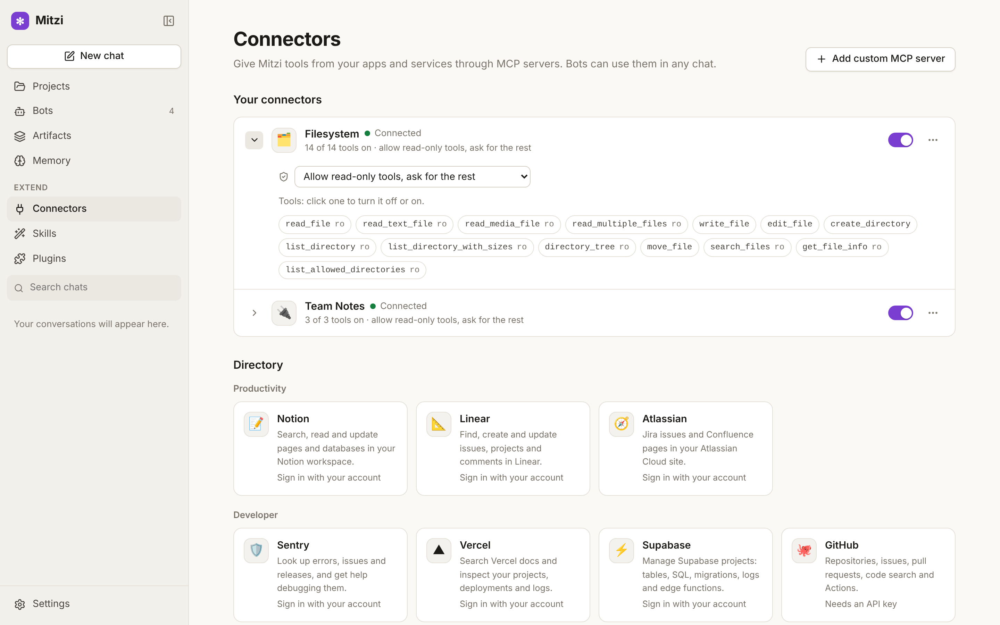

**Skills.** These are packaged instructions in Claude's `SKILL.md` format. Bots see each skill's name and description, and load the full instructions (and any supporting files) only when a task needs them. You can write skills in the app, import a skill folder, or install them with plugins. Skills in `~/.claude/skills` are picked up too.

**Plugins.** Mitzi installs **Claude Code plugins and marketplaces** as they are:
- **What a plugin contributes:** a plugin's skills, slash commands (`commands/*.md`, including `$ARGUMENTS` and `` !`shell` `` context in coding projects), agents (which become bots) and MCP servers (`.mcp.json`, which become connectors) all work. Hooks are listed but not run.
- **Sources:** install from GitHub (`owner/repo`), any git URL, or a local folder.
- **Marketplaces:** add one, for example `anthropics/claude-plugins-official`, `anthropics/claude-code` or `anthropics/skills`, and browse and install from it.
- **Slash commands:** type `/` in the chat box to pick one.

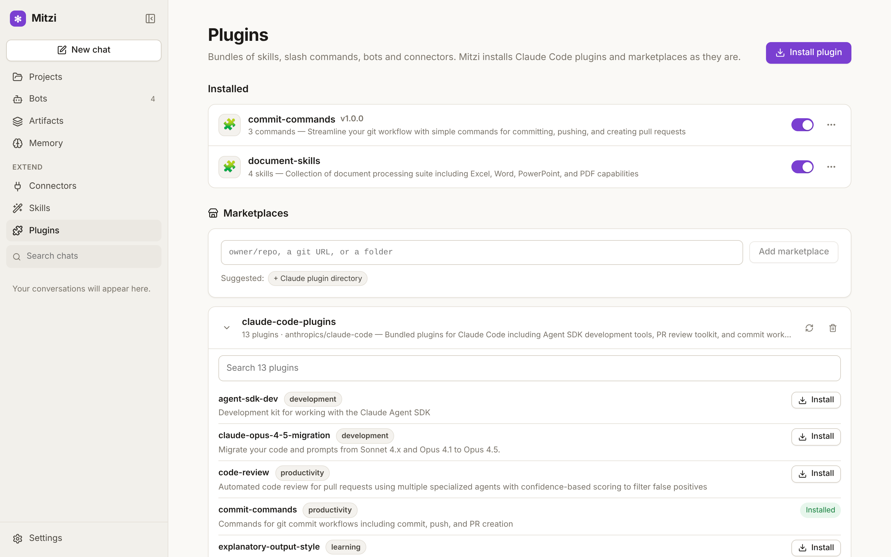

**Context management**
- A meter in the message box shows how full the model's context window is.
- The context panel breaks the window down: system prompt, project knowledge, memory, tool definitions, summary and conversation.
- When a chat nears the model's limit, older messages are summarized automatically, keeping the most recent turns word for word. You can also compact manually or restore the full history.
- You always see the complete conversation. Only the model receives the summary.

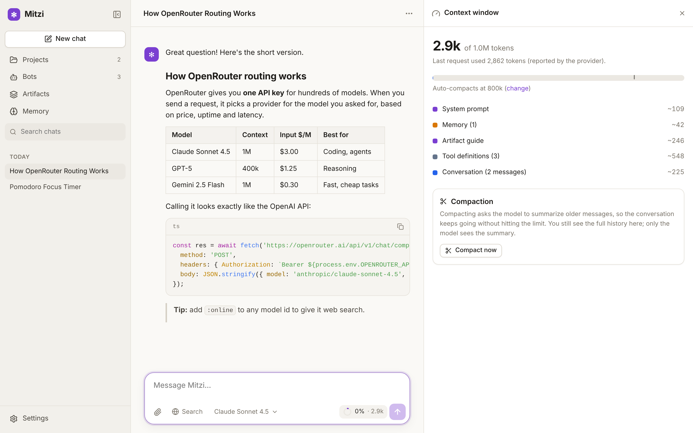

**Also included:** light and dark themes, a layout that works on phones, and a cheaper "fast model" setting for titles and summaries.

## Install

You need [Node.js 20+](https://nodejs.org) and [git](https://git-scm.com).

**macOS / Linux**, in Terminal:

```bash
curl -fsSL https://raw.githubusercontent.com/elad-haviv/Mitzi-harness/feature/web-ui/install.sh | bash
```

**Windows**, in PowerShell:

```powershell
irm https://raw.githubusercontent.com/elad-haviv/Mitzi-harness/feature/web-ui/install.ps1 | iex
```

The installer puts Mitzi in `~/.mitzi/app` and adds a `mitzi` command. On Windows it also creates Desktop and Start menu shortcuts. Run the same line again to update. Then start the app with `mitzi ui`.

### From source

```bash
git clone https://github.com/elad-haviv/Mitzi-harness.git
cd Mitzi-harness
npm install
npm run build
npm link          # puts `mitzi` on your PATH

mitzi ui          # opens the app in your browser
```

Add your OpenRouter key in **Settings**. You can get one at <https://openrouter.ai/keys>. Alternatively, set `OPENROUTER_API_KEY` before starting.

`mitzi ui` serves the app at `http://localhost:4545`. It only accepts connections from your own machine and requires a private access token, which is included in the link it prints. Use `--port` to change the port and `--no-open` to skip opening a browser.

<p>
  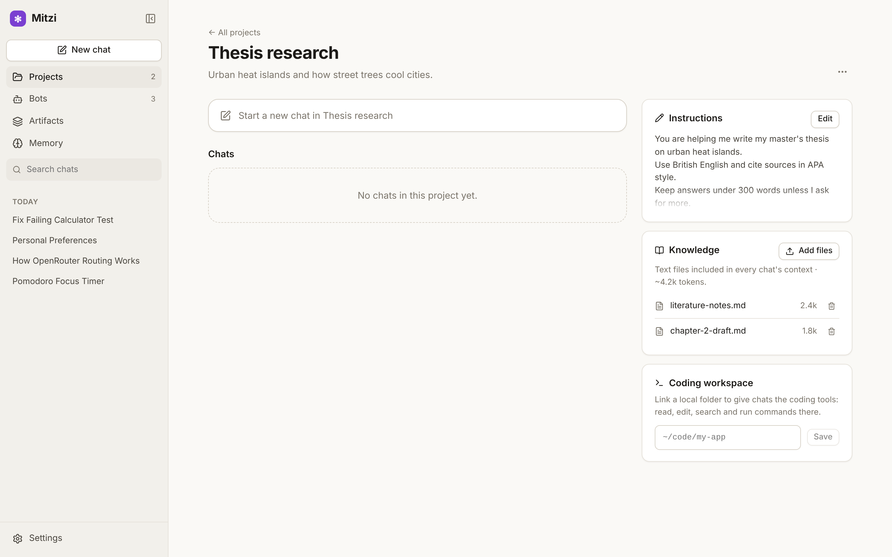
  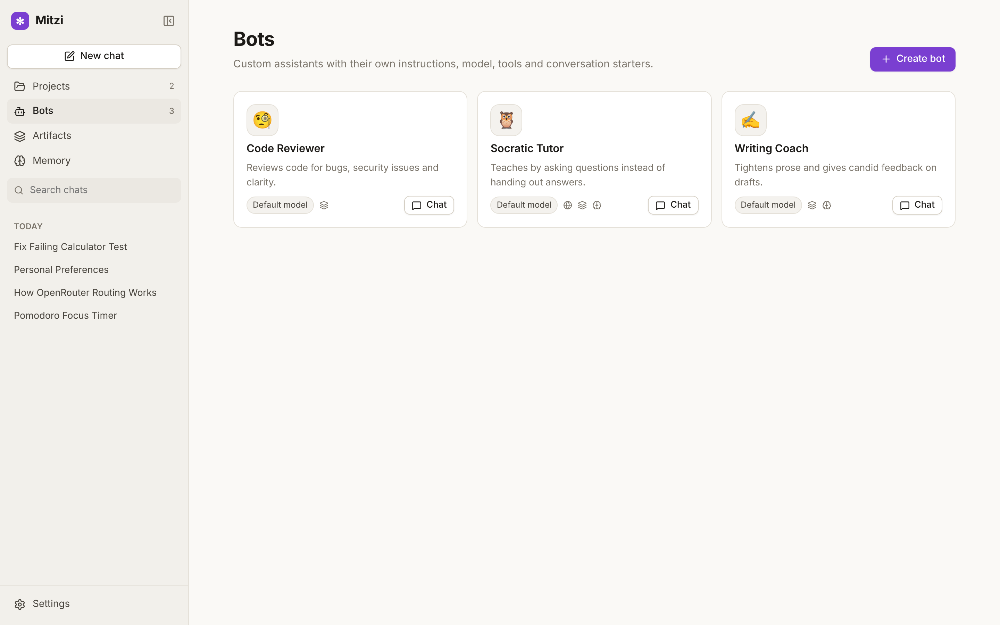
</p>

## Terminal mode

The same agent also runs in your terminal, in the style of Claude Code:

```bash
mitzi                                   # interactive session in the current directory
mitzi "explain how auth works here"     # start with a message
mitzi -p "summarize the last commit"    # print mode: answer to stdout, then exit
git diff | mitzi -p "review this diff"  # piped input
mitzi -c                                # continue the last session here
mitzi --mode plan                       # read-only planning
mitzi --allow Edit --allow "Bash(npm test)"
```

Slash commands are `/model`, `/models`, `/mode`, `/compact`, `/cost`, `/todos`, `/clear`, `/sessions`, `/init` and `/exit`. Start a line with `!` to run a shell command yourself. Permission modes: `default` asks before edits and commands, `acceptEdits` allows edits without asking, `plan` is read-only, and `yolo` never asks.

## Configuration

Settings live in `~/.mitzi/config.json`, and the app and the CLI share it. The app's Settings page edits the most common options. Project-level overrides go in `./.mitzi/config.json`.

```json
{
  "apiKey": "sk-or-…",
  "model": "anthropic/claude-sonnet-4.5",
  "smallModel": "google/gemini-2.5-flash",
  "allowedTools": ["WebFetch", "Bash(npm test)"]
}
```

| Environment variable | Purpose |
|---|---|
| `OPENROUTER_API_KEY` | OpenRouter API key (overrides the config file) |
| `OPENAI_API_KEY`, `ANTHROPIC_API_KEY`, `GEMINI_API_KEY`, `XAI_API_KEY`, `GROQ_API_KEY`, `MISTRAL_API_KEY`, `DEEPSEEK_API_KEY`, `TOGETHER_API_KEY`, `ELEVENLABS_API_KEY` | Keys for other providers; each one adds that provider |
| `MITZI_MODEL` | Default model |
| `OPENROUTER_BASE_URL` | Alternative API base URL |
| `MITZI_HOME` | Data directory (default `~/.mitzi`) |

Memory settings live in the app (Settings → Memory): the engine (built-in or a Hindsight server URL and key), an optional embedding model for semantic recall, and how many tokens of memories each message gets. The built-in engine uses your *fast model* for extraction and consolidation, so each exchange costs one or two small extra requests.

Providers added in the app are saved under `providers` in `~/.mitzi/config.json`. The CLI uses them too: `mitzi -m openai:gpt-5`.

App data (chats, projects, bots, artifacts, documents, scheduled tasks and memory banks) is stored as JSON files in `~/.mitzi/data`; generated media are in `~/.mitzi/data/media`.

> React and Mermaid artifacts load their runtime from public CDNs (unpkg, jsdelivr and the Tailwind CDN), so they need an internet connection. Web page, SVG, document and code artifacts work offline.

## Development

```bash
npm run build      # compile the server and CLI, then build the web app into dist/web
npm test           # server, agent and tool tests against a mock OpenRouter (no network)
npm run typecheck

# Live-reloading UI: run the API and the Vite dev server side by side
node dist/index.js ui --no-open     # API on :4545
npm run dev:web                     # UI on :5173, proxies /api to :4545
```

| Path | Purpose |
|---|---|
| `src/agent.ts` | Agent loop: model ↔ tools, usage, compaction |
| `src/openrouter.ts` | Streaming OpenRouter client (SSE, tool calls, retries) |
| `src/tools/` | Coding tools (Read, Write, Edit, Bash, Glob, Grep, LS, WebFetch, TodoWrite) |
| `src/permissions.ts` | Permission modes, allow rules, pluggable approvers |
| `src/server/` | Local web server: REST + SSE API, storage, prompt and context assembly, artifact tool |
| `src/server/mcp/` | MCP client (stdio, Streamable HTTP, SSE), OAuth, connection manager |
| `src/server/extensions/` | Skills, plugins and marketplaces, slash commands, connector directory |
| `src/server/memory/` | Memory banks: built-in engine (retain, recall, reflect), retrieval strategies, Hindsight adapter |
| `src/shared/types.ts` | Types shared by the server and the web app |
| `web/src/` | React app: chat view, artifacts, projects, bots, memory, settings |
| `src/index.ts`, `src/repl.ts` | CLI entry point and terminal REPL |

## License

MIT
